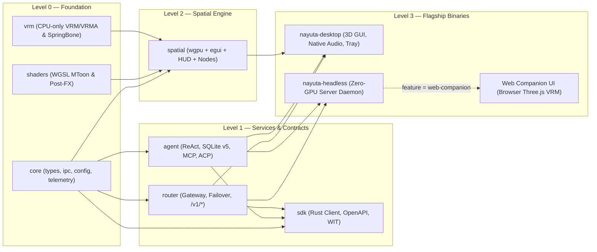

# Nayuta

**Native Rust AI Gateway, Autonomous Agent Runtime, and 3D VRM Spatial Telemetry Engine.**

`Rust Edition 2024` | `Local-First & BYOK` | `31 Crates / 11 Repositories` | `Zero-Unsafe Core` | `MIT OR Apache-2.0`

---

Nayuta adalah ekosistem AI desktop dan server berbasis **100% Rust** yang memisahkan lapisan fondasi kanonik, layanan gateway LLM, orkestrator agen otonom, dan mesin rendering spasial 3D VRM dalam satu arsitektur multi-repositori yang terukur, teraudit secara otomatis, dan siap berjalan baik sebagai aplikasi desktop 3D (`nayuta-desktop`) maupun daemon VPS tanpa GPU (`nayuta-headless`).

---

## Pilar Desain

1. **100% Native Core & Zero-GPU Daemon Parity**
   Seluruh *backend* routing, eksekusi agen, memori SQLite/vektor, sandbox WASM, dan daemon server dikompilasi menjadi biner Rust murni tanpa ketergantungan runtime eksternal di server produksi. Fitur **Web Companion 3D** bersifat opsional pada waktu kompilasi (`--features web-companion`) dan merender avatar VRM sepenuhnya di sisi browser.

2. **Local-First & Bring Your Own Key (BYOK)**
   Kredensial API disimpan secara terenkripsi di OS Keyring atau variabel lingkungan — tidak pernah ditulis ke berkas konfigurasi TOML, log telemetri, atau *bundle* frontend. Seluruh sesi, memori dokumen, tag, *tracked issues*, dan lampiran media tersimpan lokal di SQLite dengan skema terversi dan teraudit *checksum*.

3. **Pemisahan Dependensi Ketat (`GUARD-01` – `GUARD-05`)**
   Graf dependensi 31 crate dikunci ke dalam 4 tingkatan (*Directed Acyclic Graph*) dan dijaga oleh lima *Architectural Fitness Guards* otomatis pada setiap build lokal maupun GitHub Actions.

4. **Arsitektur UI Dual-Thread**
   *Main thread* didedikasikan eksklusif untuk `winit`, `wgpu`, dan `egui` agar *frame pacing* tetap responsif, sementara seluruh inferensi, jaringan, eksekusi tool, dan pengindeksan berjalan asinkron di pool `tokio` lewat *channel* perintah dan *lossy broadcast* `TelemetryBus`.

---

## Arsitektur Ekosistem (DAG Level 0 – 3)



---

## Kapabilitas Utama

### Gateway Multi-Provider, Bridge & Hybrid RAG
- **Routing & Failover (`router`):** Mendukung OpenAI, Anthropic, Google Gemini, OpenRouter, Ollama, dan LM Studio dengan *circuit breaker*, *auto-failover* terukur, serta server HTTP/SSE OpenAI-compatible (`/v1/chat/completions`, `/v1/models`, `/v1/embeddings`, `/v1/responses`).
- **Hybrid RAG & Media Lokal (`agent`, `nayuta-runtime`):** Skema SQLite **v5** dengan `LocalMediaStore` (`nayuta-media://`), `EmbeddingIndexerService` berbasis antrean *lease*, dan pencarian hibrida teks FTS + kosinus vektor.

### Orkestrasi Agen & Ekosistem Kerja
- **Eksekusi Agen Ganda:** Mesin penalaran *ReAct* internal (`AgentLoop`), klien **MCP** (`stdio`/`HTTP`), sandbox plugin **WebAssembly Component Model**, serta dukungan harness eksternal **ACP** (`ExternalAcp` JSON-RPC *stdio* dengan sanitasi environment dan persetujuan `InteractionBroker`).
- **Kolaborasi & Otomasi:** Integrasi **Git Forge** (GitHub/GitLab issue sync & gated write tools), **SkillHub** (katalog lokal/Git, pin revisi, diff preview, ekstraksi ber-jail tanpa eksekusi *hook*), **Setup Migration Preview** dari agen lain tanpa menyalin rahasia, dan **AFK Mode** yang meneruskan permintaan persetujuan (`/approve`, `/deny`) ke 5 kanal IM aktif (**Telegram, Discord, Slack, Feishu, DingTalk**).

### Mesin Spasial 3D VRM & Integrasi Desktop OS
- **VRM 0.x / 1.0 & VRMA (`vrm`, `shaders`, `spatial`):** Retargeting animasi `.vrma` terkalibrasi *hips/rest pose*, *cross-fade* antar klip, pelapisan non-destruktif (*viseme* *lip-sync*, kedipan mata, emosi agen, `LookAtController`), fisika rambut Verlet `SpringBone` (*Sphere*, *Capsule*, dan ekstensi internal *Plane*), shader `MToon`, *inverted-hull outline*, serta *HDR Bloom + ACES tone mapping*.
- **Interaksi Suara & OS (`nayuta-desktop`):** Pipeline `VoiceCallCoordinator` (antrean TTS terbatas, *VAD barge-in*, proteksi *exit phrase*), capture audio `native-audio` (`cpal` 16 kHz mono PCM16), `desktop-tray` & *global hotkey*, pemantau berkas (`notify`), *region capture overlay* multi-DPI, serta eksekutor *Computer Use* lintas-OS (dengan *kill-switch* dan *opt-in* eksplisit).

### Keamanan Remote, Web Companion & Distribusi
- **Remote TLS & File Jail (`nayuta-headless`):** Dukungan `https://` & `wss://` (`rustls` + verifikasi sertifikat/*hostname*), negosiasi kapabilitas wire, dan `RemoteFileService` *read-only* (*default-deny*, proteksi traversal/symlink).
- **Web Companion UI (`--features web-companion`):** Antarmuka browser mandiri yang dibundel dengan **Bun** + **Three.js** + **`@pixiv/three-vrm`** + **`@pixiv/three-vrm-animation`**, menerapkan *Origin allowlist*, `AuthHello` sebelum berlangganan telemetri, token di `sessionStorage`, sanitasi DOM tanpa `innerHTML`, serta kebijakan CSP ketat.
- **Signed Updater & Packaging:** Verifikasi manifes bertanda tangan Ed25519 (*pinned trust keys*), validasi SHA-256 & anti-downgrade, serta pipeline `Dockerfile.headless`, AppImage Linux, dan skrip installer Windows.

---

## Peta Repositori Organisasi

| Level | Repositori | Peran Utama |
| :-: | :--- | :--- |
| **L0** | [`core`](https://github.com/Nayuta-Agents/core) | Tipe data kanonik, trait `ChatBackend` & `EmbeddingBackend`, `TelemetryBus`, konfigurasi berlapis, dan amplop IPC |
| **L0** | [`shaders`](https://github.com/Nayuta-Agents/shaders) | Modul shader WGSL murni (`MToon`, kurva *spline* 3D, *post-FX bloom/outline*) tervalidasi `naga` |
| **L0** | [`vrm`](https://github.com/Nayuta-Agents/vrm) | Porting *CPU-only* VRM 0.x/1.0, fisika Verlet `SpringBone`, `LookAt`, dan retargeting `.vrma` |
| **L1** | [`router`](https://github.com/Nayuta-Agents/router) | Gateway AI multi-provider, *circuit breaker*, *failover*, `EmbeddingClient`, `/v1/embeddings`, dan `/v1/responses` |
| **L1** | [`agent`](https://github.com/Nayuta-Agents/agent) | Siklus *ReAct*, eksekusi *tool* paralel, MCP, SQLite/RAG v5, `LocalMediaStore`, dan `ExternalAcp` harness |
| **L1** | [`sdk`](https://github.com/Nayuta-Agents/sdk) | Pustaka klien Rust (`NayutaClient`), OpenAPI 3.1, dan kontrak plugin WebAssembly Component Model (WIT) |
| **L2** | [`spatial`](https://github.com/Nayuta-Agents/spatial) | Renderer 3D `wgpu` + `winit` + `egui`, rig avatar & komposisi layer morph, kurva API, audio HUD, dan panel HUD |
| **L3** | [`nayuta`](https://github.com/Nayuta-Agents/nayuta) | Biner aplikasi utama: `nayuta-runtime`, `nayuta-headless` (daemon VPS + `web-companion`), dan `nayuta-desktop` (3D GUI) |
| **Aset** | [`assets`](https://github.com/Nayuta-Agents/assets) | Penyimpanan Git LFS untuk model avatar `.vrm`, animasi `.vrma`, dan atribusi lisensi aset |
| **Dok** | [`docs`](https://github.com/Nayuta-Agents/docs) | *Single Source of Truth* arsitektur: PRD, Use Case, ERD, Dependency Graph, Flows, Kontrak Crate, ADR, Status & Roadmap |
| **Infra** | [`.github`](https://github.com/Nayuta-Agents/.github) | Profil organisasi, reusable CI/release workflows, dan skrip verifikasi lintas-repo + *fitness guards* |

---

## Invarians Arsitektur (`GUARD-01` – `GUARD-05`)

| Aturan | Lingkup | Batasan Teknis Terverifikasi |
| :--- | :--- | :--- |
| **GUARD-01** | `core` (`nayuta-core-*`) | Dilarang menarik `axum`, `reqwest`, `wgpu`, `winit`, `egui`, atau fitur `tokio` selain `sync`. |
| **GUARD-02** | `vrm` (`nayuta-vrm-*`) | Komputasi murni CPU; dilarang menarik `wgpu`, `winit`, `egui`, atau `nayuta-shader-*`. |
| **GUARD-03** | `agent` (`nayuta-agent-*`) | Terisolasi dari `nayuta-router-*`; hanya berkomunikasi lewat trait di `nayuta-core-types`. |
| **GUARD-04** | `nayuta-headless` | Bebas `wgpu`, `winit`, `egui`, `nayuta-spatial-*`, dan `nayuta-shader-*` (termasuk dengan `--features web-companion`). |
| **GUARD-05** | `spatial` & `nayuta` | Wajib tepat satu versi `wgpu` (`30.0.1`) dan satu versi `winit` (`0.30.13`) di pohon dependensi. |

---

## Verifikasi & Benchmark Terukur

Pengukuran dan verifikasi akhir dijalankan pada host Linux x86_64 2-core dengan profil `--release` dan direktori `HOME`/`TMPDIR` terisolasi:

| Metrik / Gerbang Uji | Hasil Terukur | Cakupan |
| :--- | :--- | :--- |
| **Suite Multi-Repo (`.github/scripts/check-all.sh`)** | **546 lulus, 0 gagal, 2 ignored** | Seluruh 8 workspace Rust (`fmt`, `clippy -D warnings`, zero manifest warning) |
| **Test Aset `--ignored` (VRM & VRMA)** | **2/2 lulus** | `nayuta-vrm-animation` (`.vrma`) dan `nayuta-desktop` (`JK.vrm`) |
| **Guard Fixtures & Fitness Guards** | **21/21 fixtures + 5/5 guards lulus** | Pengujian positif & negatif untuk `GUARD-01` – `GUARD-05` |
| **Web Companion (`web-companion` + Bun)** | **13/13 Rust + 14/14 Bun lulus** | API, CSP, Origin/AuthHello, `GUARD-04` bersih, bundle TS/Three.js (`bun v1.4.5`) |
| **NFR-02 (Overhead `Router::chat_stream`)** | **P50 `0.0601 ms` / P99 `0.1346 ms`** | Target `< 0.5 ms P99`; `n=2000` in-process (loopback HTTP `P99 = 3.7933 ms`) |
| **NFR-04 (Idle RAM `nayuta-headless serve`)** | **`18.75 MiB` (`19,204 kB` `VmRSS`)** | Target `< 25 MB` RAM idle daemon Linux |
| **NFR-03 (CPU Tick `AvatarRigController` + 10 Stream)** | **Mean `0.2117 ms` / P99 `0.7495 ms`** | Target `<= 16.6 ms`; tick CPU `n=600` (swapchain GPU interaktif belum dijalankan) |

---

## Quickstart Ekosistem

Susun seluruh repositori secara berdampingan (*sibling layout*) dan konfirmasi seluruh invarians arsitektur:

```bash
# Kloning seluruh repositori pada direktori induk yang sama
for repo in core shaders vrm router agent sdk spatial nayuta assets docs .github; do
  git clone --branch dev "https://github.com/Nayuta-Agents/${repo}.git"
done

# Verifikasi lintas-repositori (Linux/macOS)
bash .github/scripts/check-all.sh
```

Detail instalasi biner aplikasi tersedia di [README `nayuta`](https://github.com/Nayuta-Agents/nayuta), sedangkan spesifikasi teknis lengkap tersedia di [repositori `docs`](https://github.com/Nayuta-Agents/docs).

---

## Lisensi

Seluruh kode sumber dan dokumentasi di ekosistem Nayuta dilisensikan secara ganda di bawah **MIT OR Apache-2.0**.
